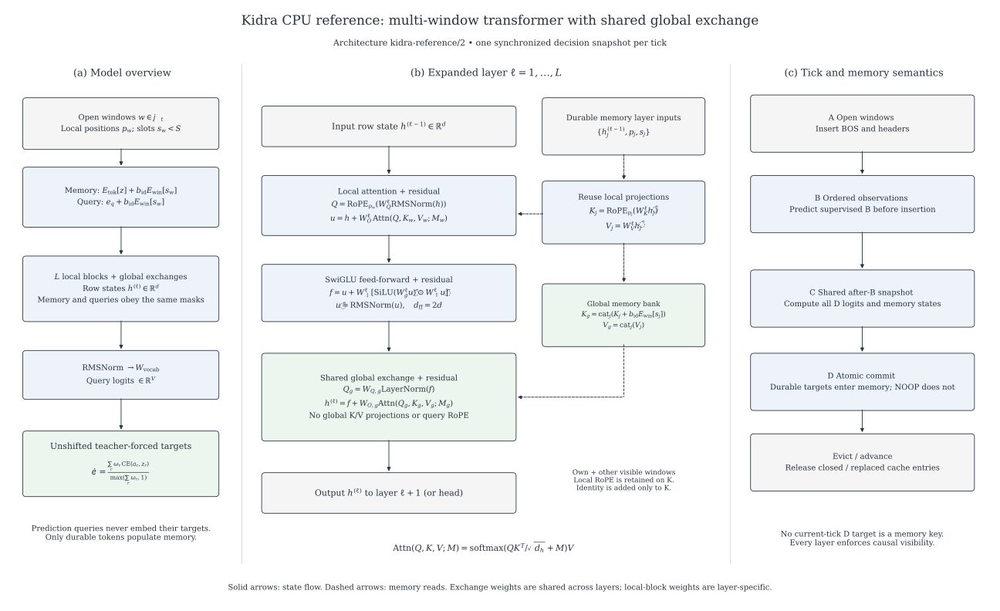

# Kidra model architecture



**Figure 1.** Implemented `kidra-reference/2` architecture. **(a)** Durable token
representations and label-free prediction queries traverse the same stack with
causally valid memory reads. Only prediction queries feed the vocabulary head and
weighted target loss. **(b)** Each layer performs window-local attention, a dense
SwiGLU block, and the ProjectKidra-style global exchange. The exchange reads local
K/V projections; its query and output parameters are shared across all layers.
**(c)** External-first tick execution separates the shared decision snapshot from
target commit. Replacement becomes invisible at its B-phase boundary; physical
cache cleanup may occur after D.

Open the [vector SVG](figures/kidra-architecture.svg) for zooming or use the
[vector PDF](figures/kidra-architecture.pdf) for a paper or presentation. A
[high-resolution PNG](figures/kidra-architecture.png) is also available. The figure
uses conventional research-paper presentation: labeled panels, serif mathematical
notation, explicit residual equations, thin arrows, a white background and light
functional group colors. Meaning does not depend on color alone.

## Configurable hyperparameters

Symbols denote settings rather than a particular toy-model size. Parameter tensors
are shared across windows unless a window embedding is explicitly indexed.

| Symbol | Rust `ModelConfig` field | Meaning / constraint |
|---|---|---|
| $V$ | `vocab_size` | Vocabulary cardinality; token IDs satisfy $0 \le z < V$. |
| $d$ | `hidden_size` | Hidden width; even, allowing paired RoPE coordinates. |
| $L$ | `layers` | Number of local-block/global-exchange stages. |
| $S$ | `max_windows` | Window identity slot capacity; exported slot $s_w \in \{0,\ldots,S-1\}$. |
| $b_{\mathrm{id}}\in\{0,1\}$ | `window_embeddings` | Enables identity additions in input embeddings **and** global keys. |
| $b_g\in\{0,1\}$ | `global_attention` | Enables exchange after each local block; when disabled, $h^{(\ell)}=f$. |
| $\theta$ | `rope_theta` | Local RoPE frequency base; finite and greater than one. |
| $r_{\mathrm{init}}$ | `seed` | Parameter-initialization seed; does not encode logical time. |

The CPU oracle currently fixes the head count $H=1$, head width $d_h=d$, and
feed-forward width $d_{\mathrm{ff}}=2d$. These are shown symbolically where helpful,
but are **not independently configurable fields**. Arbitrary multi-head/grouped
Qwen attention and configurable feed-forward expansion belong to the later
production backend. No particular number of windows is assumed.

## State, tensors and masks

| Symbol | Shape / domain | Meaning |
|---|---|---|
| $t$, $\mathcal W_t$ | Logical tick; set of open windows | Independent of wall-clock time and GPU placement. |
| $s_w$, $p_w$ | Slot; nonnegative local insertion position | NOOP does not advance $p_w$. Replacement resets it to the surviving initialization prefix. |
| $h^{(\ell)}$, $u$, $f$ | $d$ | Row state, local-attention residual, and feed-forward residual. |
| $E_{\mathrm{tok}}$, $E_{\mathrm{win}}$ | $V\times d$, $S\times d$ | Token and window-identity tables. |
| $e_q$ | $d$ | Shared prediction-query seed, independent of target token ID. |
| $W_Q^\ell,W_K^\ell,W_V^\ell,W_O^\ell$ | $d\times d$ | Layer-specific local attention projections. |
| $W_g^\ell,W_\uparrow^\ell,W_\downarrow^\ell$ | $d_{\mathrm{ff}}\times d$, $d_{\mathrm{ff}}\times d$, $d\times d_{\mathrm{ff}}$ | Layer-specific SwiGLU parameters. |
| $W_{Q,g},W_{O,g}$ | $d\times d$ | Global query/output projections, shared across layers. |
| $K_w,V_w$ | $m_w\times d$ | Local projected memory for the query's own window. |
| $K_g,V_g$ | $m\times d$ | Global memory bank across visible windows, including the query's own window. |
| $M_w,M_g$ | $1\times m_w$, $1\times m$ | Additive masks: zero for allowed keys, negative infinity for blocked keys. |
| $W_{\mathrm{vocab}}$, $a_r$ | $V\times d$; $V$ | Untied output projection and prediction logits for row $r$. |
| $z_r$, $\omega_r$ | Token ID; nonnegative scalar | Unshifted target and effective loss weight; weight already includes loss masking. |

Bank sizes $m_w,m$ depend on the query, window lifetimes and replacement
boundaries. They are context sizes, not model hyperparameters. In the equations,
$V$ is vocabulary size while subscripted $V_w,V_g,V_j$ denote attention values.
The implementation can filter forbidden rows instead of explicitly materializing
negative-infinity masks. An empty attention bank returns the residual unchanged.

## Reading the expanded layer

1. Start with a memory embedding $E_{\mathrm{tok}}[z]$ or a prediction seed $e_q$,
   optionally adding the exported window slot embedding. Prediction queries never
   receive their own target embedding.
2. Apply RMS normalization and layer-specific local projections. RoPE rotates Q
   and K using **window-local** positions, with frequency
   $\theta^{-2i/d_h}$ for pair index $i$. Values are not rotated.
3. Read only causally visible own-window memory, then add the local attention
   residual. The normalized residual feeds SwiGLU and its residual addition.
4. Build the global query from LayerNorm of the post-local-block state. For each
   allowed durable memory row, reuse that layer's local projected key and value:
   $\widetilde K_j=K_j+b_{\mathrm{id}}E_{\mathrm{win}}[s_j]$, while
   $\widetilde V_j=V_j$. Global queries receive no additional RoPE. Global K/V
   receive no new projections from post-local hidden states.
5. Perform masked scaled dot-product attention and add the shared output
   projection to the post-local state. Repeat for $L$ layers. RMS normalization
   and the vocabulary projection produce query logits, with no label shifting.

Both memory representations and prediction representations obey causality at
**every layer**. Only durable tokens become keys; excluded-loss observations may
still condition predictions. A closing window remains readable through its EOS
D phase and is unavailable afterward. Same-tick generated targets cannot serve
as keys to any same-tick query, even in another window. Same-tick B observations
are available to D, while a supervised B query sees only earlier B ranks and A.

## Implementation boundaries and provenance

The figure describes the existing deterministic f64 CPU oracle and its
teacher-forced replay, rather than a completed Qwen model or production generator.
RMS normalization uses epsilon $10^{-6}$; exchange LayerNorm uses epsilon
$10^{-5}$ with identity affine parameters. Exchange linear biases are zero.
The reference reconstructs projected K/V from immutable per-layer memory inputs;
it does not yet maintain optimized projected GPU KV buffers. Initialization rows
follow the upstream A-phase visibility predicate.

The exchange follows the original ProjectKidra `model/exchange.py` at revision
`5e78cfb765aed2b54e575c6bc85f9648007b0596`, specialized to one head and constrained
by Trajectory Remix visibility. It is distinct from ProjectKidra's low-rank,
grouped-query `qwen/exchange.py` adapter. See [exchange alignment](global-exchange.md)
for source links and [the architecture document](architecture.md) for crate,
backend, device, persistence and security boundaries. GPU partitioning and
training autograd are not depicted as operational features.

## Reproduce the figure

The editable figure source is [scripts/draw-architecture.py](../scripts/draw-architecture.py).
Rendering requires only a **development** Python environment with Matplotlib
(tested with 3.10.8); Tesslot has no Python runtime dependency:

```sh
python3 scripts/draw-architecture.py
```

SVG and PDF retain vector geometry; the PNG is rendered at 200 dpi. The diagram
is documentation only and does not change model execution or numerical results.
