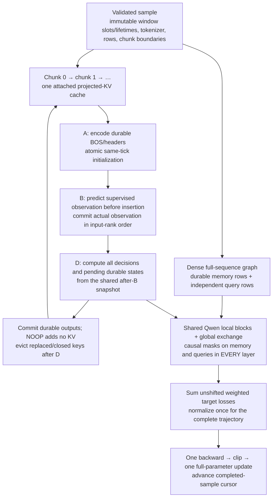

# Native Qwen training on Trajectory Remix exports

This CPU reference gate connects Qwen local blocks and full-rank Kidra exchange
to the native `kidra-token-chunk/1` reader. It trains **all parameters** on whole
trajectories, retaining differentiable projected K/V across storage chunks.
It implements supervised B-before-insert queries, parallel D decisions, weighted
unshifted targets, NOOP loss without memory growth, window lifetimes and replacement.

This is an opt-in headless numerical/training path. Production HTTP training jobs,
dashboard dataset registration, general online generation and large pretrained
model training remain unavailable. The existing echo/corpus dashboard experiments
continue to use their independent models and checkpoint formats.

## Run and resume

```sh
mkdir -p checkpoints
cargo run -- train-remix-demo fixtures/autograd.jsonl \
  --tokenizer-file fixtures/demo-tokenizer.json \
  --steps 80 --output checkpoints/remix-80

# Twenty additional whole-trajectory updates, continuing model/optimizer/data state:
cargo run -- train-remix-demo fixtures/autograd.jsonl \
  --tokenizer-file fixtures/demo-tokenizer.json \
  --steps 20 --resume checkpoints/remix-80 --output checkpoints/remix-100
```

Fresh initialization accepts `--windows` (default 7) and `--seed` (default 42).
They conflict with `--resume`; the checkpoint supplies those settings. Steps are
1–4,000 **additional complete-sample updates**, not independent chunk updates.
The output must be a new directory with an existing parent. Each update emits
actual JSON loss/gradient norm, sample/trajectory identity, effective target weight
and chunk count; the final event identifies the published checkpoint. Per-update
loss is measured before that update.

The actual tokenizer JSON is loaded natively, with no padding/truncation, to derive
its normalized fingerprint and dedicated controls. No identity is guessed from
observed token IDs or a matching vocabulary size. The demo initializes random
Qwen-compatible weights specifically for that tokenizer: for the canonical tokenizer,
the model has vocabulary 101, hidden width 16, one layer, four query/two KV heads,
head dimension 8 and seven window slots (6,048 trainable scalars). Local context
capacity is 256 to accommodate the canonical headers. This does **not** relabel
the ASCII echo fixture's embeddings or import pretrained weights into a new token
mapping. `remix_from_aligned` is the bounded Rust entry point for explicitly
token-aligned tiny Qwen weights; it rejects incompatible vocabulary/control metadata.
Real Qwen tokenizer extension and embedding-row conversion remain a separate gate.

The trainer preflights the **entire** export before the first update, including
suffix samples not reached by the requested step count. It rejects incompatible
tokenizers/controls, malformed samples, missing chunks, unsupported bounds and
samples with no effective targets. It streams one reconstructed trajectory at a
time, in file order, repeating the file as needed. The absolute completed-sample
counter determines the next sample modulo the validated sample count. There is
no shuffling, dataset mixing or gradient accumulation in this trainer yet.

The complete file SHA-256 binds sequential resumption. A changed file is rejected,
including changes to whitespace or ordering. Hashes are checked around preflight
and before checkpoint publication; input files must remain immutable during a run.
An unbound native checkpoint cannot acquire a sequential cursor after training.

## Two executions of the same architecture

`kidra-qwen-remix/1` uses the existing seven added tensors and the same local
Qwen RMSNorm, Q/K per-head normalization, split-half window-local RoPE, GQA and
SwiGLU blocks as the echo experiments. Exchange follows each local block, sharing
LayerNorm/Q/output parameters across layers. It reads **the local projected RoPE K
and local V**, adds KV-width window identities to K, and applies the residual
output. There is no additional global K/V projection or global query RoPE.

The shared numerical kernel accepts explicit allowed masks and either dense
durable rows or attached prefix K/V:



The dense path computes every memory representation with its own historical
causal mask; a future-contaminated memory state is never repaired by a final-only
mask. The incremental path constructs durable states at insertion time and stores
each layer's local K/V. A supervised B query uses a label-free prediction seed;
its actual token is a separate durable state. D queries and pending durable states
share the same precommit cache. Same-tick D outputs cannot influence each other
through any transformer layer.

Visibility uses `tesslot_core::visible_to`, ported from the real Remix compiler.
The current upstream `EXPORT.md`, `training.py` and `compiler.py` were rechecked
and match the pinned fixture revision `d2c8083536d56a33d876e2650ae855722d491566`.
Automatic headers, excluded observations, supervised external inputs, tool results,
UUID-assigned slots and removal/lifetime metadata remain intact. No upstream
Python runtime or modified Trajectory Remix checkout is used by Tesslot.

Closing a window removes its direct keys after D. Replacement makes old keys
unreadable at its B boundary (including empty replacements), with physical eviction
after the tick. Their graphs may legitimately remain reachable through surviving
states or losses created while those keys were visible. **Eviction does not detach
those graphs or erase information already incorporated into other representations.**
NOOP predicts a target without advancing durable position or cache length.

Each cache is bound to a model instance, optimizer step and sample identity.
Reusing it across samples/models/updates is rejected, as is skipping/repeating
prefix rows or restarting a cache at a later storage chunk. Chunk boundaries never
detach, backward or update; a fresh cache is used for each complete-sample forward.
This is true projected-KV replay of a validated export schedule, not an online
session API for arbitrary replacement/lifecycle commands or free-running tools.

## Objective, optimizer and persistence

Labels are unshifted. Loss is
`sum(effective_weight × cross_entropy) / max(sum(effective_weight), 1)`.
The clamp matters when total effective weight is below one. Loss masks do not
remove durable context and NOOP targets can have positive loss without being keys.
For FP32 stability, weights are normalized in host scalar precision before the
weighted FP32 reduction. Overflowing sums or coefficients that underflow FP32 are
rejected. Every required positive-weight query must be present exactly once.

AdamW uses learning rate 0.003, β₁=0.9, β₂=0.999, ε=1e-8, decay 0.01 and gradient
clipping at one. All parameters, including pretrained-compatible local block
tensors, identities and query/exchange parameters, are eligible for optimization.
Unused parameters receive explicit zero gradients; decay still applies. No LoRA
or frozen-base substitution is introduced. Tensor storage/operations are FP32;
host positional constants and weight accounting use higher scalar precision.

`tiny-qwen-remix-adamw/1` (and native explicit-SGD `tiny-qwen-remix-sgd/1`) stores
model configuration/weights, moments and optimizer hyperparameters/count, architecture
and export versions, exact tokenizer identity/controls, source provenance/full
weight-file hash, conversion version/seed, dataset file hash and completed-sample
cursor. Restore validates all versions, bounds, shapes and checksums before use.
The existing temporary-directory and synced publication mechanism is reused;
existing destinations are never overwritten. CLI interruption before final save
discards unsaved progress; previous checkpoint directories remain valid. There is
no persistent job scheduler, periodic checkpointing or Ctrl-C resume claim.

## Opt-in verification and limits

```sh
./scripts/test-qwen-remix.sh
```

All six numerical/CLI integration gates are ignored by ordinary CI:

* Dense versus attached chunk execution: logits and **every named parameter's**
  gradients agree on one- and two-layer models (FP32 absolute logit tolerance
  2e-5, gradient tolerance `3e-4 × (1 + |g|)`).
* Two-layer finite differences of nine embedding/local-attention/norm/exchange
  coordinates: ε=1e-3 and tolerance `2e-3 + 0.02 × |g|`, allowing FP32 reduction
  roundoff and finite-difference normalization sensitivity.
* A later loss reaches a replaced prefix via a surviving dependent state;
  deliberately detaching prefix K/V removes that gradient contribution.
* Two-layer future/same-tick target noninterference, supervised B-before-insert,
  fractional-weight clamping, missing-target rejection, NOOP cache behavior,
  closures and cache ownership/isolation.
* The real canonical **429-row, four-window** exporter fixture exercises headers,
  tool results, replacement and late opens. Dense/cached logits agree within
  3e-5; cached output is bit-identical across equivalent chunkings.
* Eighty whole-trajectory updates reduce the autograd fixture's measured loss
  **4.593745 → 0.514564**. Model/optimizer/manifest bytes match after the next
  resumed update. The actual CLI additionally compares a two-sample resumed run
  with uninterrupted training and rejects a malformed suffix before any update.

These are CPU reference tolerances, not GPU or mixed-precision guarantees. Cheap
ordinary tests also revalidate materialized samples to catch caller mutations.
Existing echo/corpus numerical and HTTP experiments remain regression gates.

Limits are explicit: 512 rows/sample or live cache budget, 1–64 window slots,
256 vocabulary/context, hidden/head width ≤64, ≤8 query/KV heads, ≤4 layers and
intermediate width ≤256; the CLI caps exports at 64 MiB and JSONL lines at 8 MiB.
The larger 4,103-row idle fixture remains supported by the dataset reader but is
outside this numerical gate. No large model download, CUDA functionality, multiple
device placement, mixed precision, activation checkpointing, packed batching or
production SFT job lifecycle is claimed.

Next: trajectory-level evaluation/rollouts, accumulation with correct effective
weight normalization, backend job scheduling/metrics and opt-in NVIDIA execution.
Real pretrained tokenizer/control conversion and device memory budgeting must be
completed before attempting 0.6B full-parameter SFT.

Verification for this increment: workspace build, formatting and Clippy with
warnings denied pass. The CPU CI feature set passes 50 ordinary tests, with
16 computational tests ignored by default. All six Qwen/Remix gates and all ten
existing echo/corpus gates passed when explicitly run. No NVIDIA execution was
performed; no new browser workflow is claimed for this headless command.
