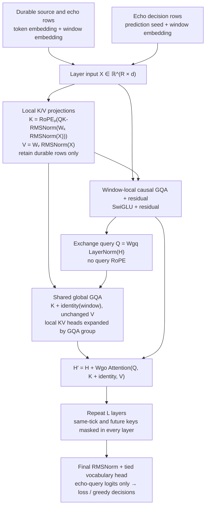

# Two-window echo experiment

Run `cargo run -- serve --tiny-experiment`, then open the **Two-window echo
experiment** panel in Inference or Training. Choose a pattern seed (default 42),
press **Generate pattern & echo**, then **Train echo window** (default 400 steps).
The source pattern is generated automatically; users never type target letters.
The panel shows both windows, measured loss/gradient norms, free-running accuracy,
and a tick timeline. Training continues when the browser disconnects. Stop takes
effect between complete optimizer updates. The base ABC experiment remains separate.

## Protocol and causal context

`kidra-qwen-echo/1` fixes **two windows** and **N = 12** letters for this experiment.
These are experimental task bounds, not production Kidra capacity limits.
Window 0 is driven by a seeded SplitMix64 runtime RNG over lowercase ASCII `a`–`z`;
its letters are random source decisions, **not neural-network sampling**. Window 1
is the trainable model. ASCII byte IDs are used instead of a production tokenizer.

At tick `t`, both windows decide from the same precommit snapshot. A durable key
at tick `k` is visible only when `k < t`, in **every layer**. Window-local positions
start at zero independently. Queries use a trainable seed plus a window embedding;
their target token is never an input to their own query. Query rows cannot be keys.
Window 1 starts at tick 1 and echoes the preceding source decision, draining at
tick N. Window 0's current-tick random letter becomes visible at the next tick.

| Tick | Window 0 decision | Window 1 target | Last visible source position |
|---|---|---|---|
| 0 | s₀ | inactive | none |
| 1 | s₁ | s₀ | 0 |
| 2 | s₂ | s₁ | 1 |
| … | … | … | … |
| N−1 | sₙ₋₁ | sₙ₋₂ | N−2 |
| N | inactive | sₙ₋₁ | N−1 |

Training repeats the selected random pattern. Only the N echo targets contribute
to mean cross entropy; source decisions have zero loss. Earlier teacher-forced
echo letters become durable context at their own ticks, with no detach inside a
trajectory. Free-running replay feeds back **model-generated echo IDs**, never the
reference echo history. Full-sequence logits and prefix recomputation are compared
with teacher-forced equivalent histories. This is uncached recomputation, not a
production incremental KV implementation.

## Numerical architecture

The 5,184-parameter base is converted natively using the existing tensor mapping.
The seven added tensors produce a **6,320-parameter** default model: window input
embeddings, prediction seed, KV-width identities, shared full-rank exchange Q/out,
and trainable exchange LayerNorm scale/bias. All twenty tensors are eligible for
the same clipped full-parameter SGD update; every gradient must exist and be finite.

Here d is hidden width, L is layer count, Hq/Hkv are query/KV heads, h is head
dimension, and R counts durable plus query rows. Default values are d=16, L=1,
Hq=4, Hkv=2, h=8. Q width Hq·h=32 deliberately differs from d; KV width is 16.
Masks exclude other windows for local attention and permit both windows for global
attention. Empty visible sets yield a zero response with finite backward gradients.

This implements the full-rank GQA extension already specified by
`kidra-qwen-tensors/1` of the original [ProjectKidra GlobalExchange](global-exchange.md):
queries from post-block LayerNorm, shared exchange parameters across layers,
**the same local RoPE K and local V** as the local block, identity offsets on K,
and a residual output. There are no extra global K/V projections. Separate input
and KV identity tables handle unequal widths. Exchange linear biases are zero;
this is not an exact Python checkpoint port or its distinct low-rank Qwen adapter.
The echo protocol explicitly versions these choices. Production lifecycle,
NOOP/EOS policies, general trajectory integration and window count remain separate.

## API and checkpoints

All paths use `/api/window-v1/` and the same opt-in switch as the base experiment:

| Method | Path suffix | Body / behavior |
|---|---|---|
| GET | inference/experiments/tiny-qwen-echo/status | enabled, busy, real metrics, last echo report |
| POST | inference/experiments/tiny-qwen-echo/generate | `{"seed":42}`; generate source and replay trained echo |
| POST | training/experiments/tiny-qwen-echo/jobs | `{"steps":400,"seed":42}`; seed defaults to 42, steps 1–1000 |
| POST | training/experiments/tiny-qwen-echo/stop | stop after completed update |
| POST | training/experiments/tiny-qwen-echo/checkpoint | save all base/exchange tensors |
| POST | training/experiments/tiny-qwen-echo/restore | validate and restore latest echo checkpoint |

Reports distinguish teacher-forced loss from free-running accuracy. Source-masked
loss recomputes all layers with source keys hidden from echo rows, including
earlier echo memory, so indirect source contamination cannot survive the ablation.

Echo checkpoints live under `.tesslot/tiny-qwen/echo/`, independently of the ABC
model. `tiny-qwen-echo-sgd/1` stores the two-window architecture, all weights,
source config, checksum, tokenizer, SGD learning rate and completed step. Loading
validates the architecture and exact tensor set before replacing the model. Older
base `tiny-qwen-sgd/1` checkpoints remain supported in the base experiment.
The pattern seed is a **per-request task input**, not model state: supply the same
seed to continue the same task after restoring. Job progress and seeds are not
automatically resumed after restart. No new model weight file is tracked.

## Opt-in verification

`./scripts/test-tiny-qwen.sh` runs the base experiments plus:

* 400 full-parameter echo updates, finite nonzero gradients, loss reduction, exact
  free-running 12-letter replay, and a source-masking ablation that must harm both
  loss and replay accuracy.
* Save/restore equality of replay and the next SGD update.
* One- and two-layer future/same-tick/target noninterference and full/prefix-logit
  equality (absolute tolerances 1e-6 / 2e-6 for FP32 reduction differences).
* An attached-source gradient check: first-echo loss reaches local V weights when
  source memory is visible and gives exactly zero V gradient when it is hidden.
* The real HTTP workflow, independent base/echo states, restart/restore and invalid
  request rejection. Browser verification is separately opt-in via
  `node scripts/tiny-qwen-browser.cjs` with Playwright/Chromium and a server on 8081.

All computational experiments are `#[ignore]` in ordinary CI. No CUDA, Python,
pretrained downloads or real model files are needed.

Measured CPU results with seed 42: **4.865631 → 0.014095** in 400 steps; source
`jbkquuxmrgvc`, echo `jbkquuxmrgvc` (**12/12**). Source-masked loss was **0.532773**
and free-running accuracy **0/12**. A single unseen seed (43) scored **3/12**;
learning this selected pattern does **not** demonstrate general copying ability.
Multi-pattern training and held-out evaluation are the next experimental gates.

The CI feature set passes 46 CPU tests with seven computational tests ignored;
all seven pass through the opt-in script. Build, formatting and Clippy with
warnings denied pass. The Chromium check also passes generation, 400 echo steps,
the 13-tick timeline and independent base/echo save/restore. No GPU execution was
performed or inferred from these CPU results.
